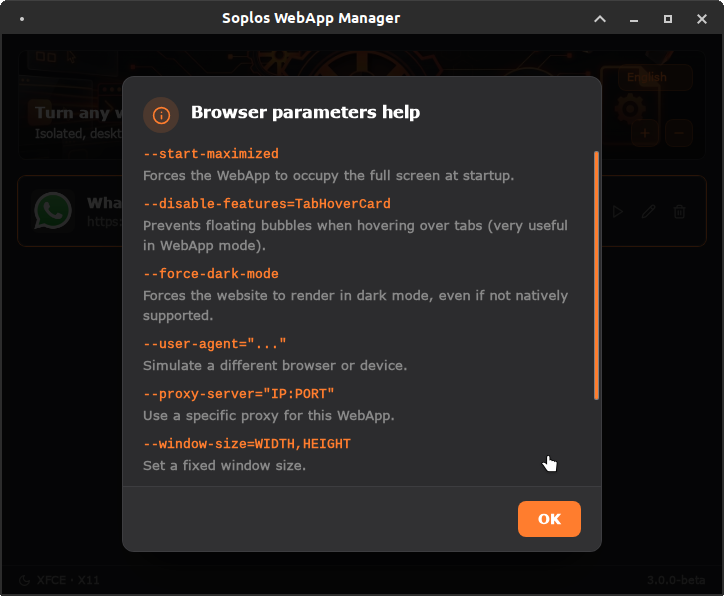
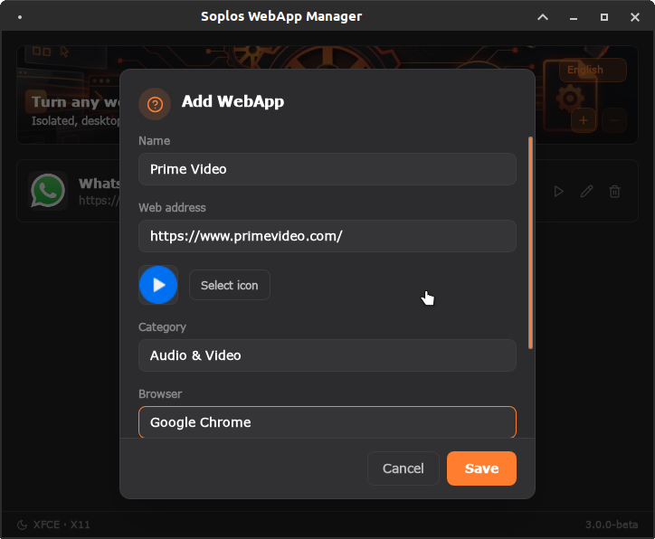

# Soplos WebApp Manager 3.0

Create and manage isolated web applications for Soplos Linux.

It turns any website into its own desktop app: its own window, its own taskbar icon, its own isolated browser profile, using whichever browser you already have installed.

## Screenshots

| | |
|---|---|
|  Main window with the hero banner and the list of WebApps |  Editing a WebApp's name, address, icon and browser |
|  Help for the extra browser launch parameters |  Adding a new WebApp with automatic favicon lookup |

## Architecture

Version 3.0 is a ground-up rewrite of Soplos WebApp Manager. The original app was written in Python 3 with GTK3 (PyGObject), the same skeleton every other Soplos GTK tool follows. This rewrite replaces that entire stack with Tauri 2: a Rust backend and a Svelte 4 + Tailwind CSS frontend, rendered through the system's WebKitGTK — the same architecture introduced by Soplos Welcome 3.0.

- **Backend** (`src-tauri/`): creating, editing, deleting and running a WebApp is all plain filesystem work under the user's own home directory (`~/.local/share/applications/soplos-webapp-*.desktop` and `~/.local/share/soplos-webapps/<id>/`) — nothing here needs root, so there is no `pkexec` anywhere in this app. Browser detection covers both native binaries and Flatpak installs; favicon lookup falls back through DuckDuckGo's icon proxy and Google's favicon service; icons are read back as `data:` URIs so the frontend never needs filesystem access of its own.
- **Frontend** (`src/`): a single-window app (no section tabs, unlike Welcome), shared popup components, and the 8-language dictionaries under `src/i18n/`.

This is the second Soplos application ported to this architecture, after Soplos Welcome 3.0. The plan is to move the rest of the Python/GTK3 Soplos tools to the same pattern over time.

## Installation

```bash
sudo apt install soplos-webapp-manager
```

Open it from the applications menu. Press F1 for the About dialog.

## Features

- Create a WebApp from any URL, with its own isolated browser profile and desktop entry.
- Works with whichever supported browser you already have installed: Firefox, LibreWolf, Zen Browser, Chromium, Google Chrome, Brave, Vivaldi, Opera, Opera GX, Microsoft Edge, Helium or GNOME Web — native or Flatpak.
- Drag a link from your browser's address bar onto the window to create a WebApp from it directly.
- Automatic favicon lookup, or pick your own icon.
- Optional navigation bar, incognito mode and extra browser launch parameters per WebApp.
- Edit or delete any WebApp at any time; deleting removes its desktop entry and its isolated profile.
- Keyboard shortcuts: F1 (About), Ctrl+N (Add), Delete (remove selected), Ctrl+Q (quit).

## Languages

The interface is available in English, Spanish, German, French, Italian, Portuguese, Romanian and Russian. It starts in the system language and falls back to English. The language can be changed at any time from the hero banner.

## License

GPL-3.0-or-later. See `LICENSE`.
