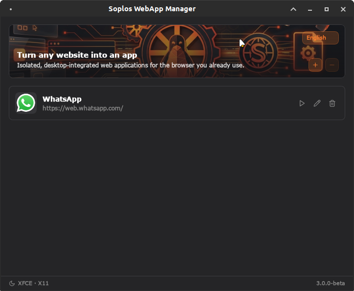
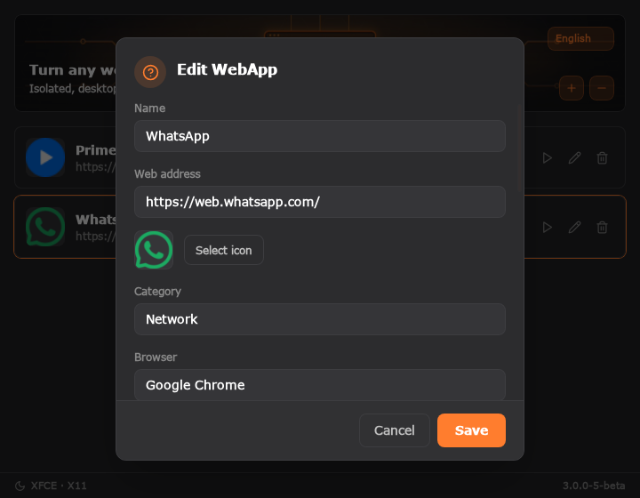

# Soplos WebApp Manager 3.0


Create and manage isolated web applications for Soplos Linux.

Turns any website into its own desktop app: its own window, its own taskbar icon, its own isolated browser profile, using whichever browser you already have installed.

## Screenshots

| | |
|---|---|
|  Main window with the hero banner and the list of WebApps |  Editing a WebApp's name, address, icon and browser |
|  Help for the extra browser launch parameters |  Adding a new WebApp with automatic favicon lookup |

## Features

- Create a WebApp from any URL, with its own isolated browser profile and desktop entry.
- Works with whichever supported browser you already have installed: Firefox, LibreWolf, Zen Browser, Chromium, Google Chrome, Brave, Vivaldi, Opera, Opera GX, Microsoft Edge, Helium or GNOME Web — native or Flatpak.
- Drag a link from your browser's address bar onto the window to create a WebApp from it directly.
- Automatic favicon lookup, or pick your own icon.
- Optional navigation bar, incognito mode and extra browser launch parameters per WebApp.
- Edit or delete any WebApp at any time; deleting removes its desktop entry and its isolated profile.

## Architecture

Version 3.0 is a ground-up rewrite of Soplos WebApp Manager. The original app was written in Python 3 with GTK3 (PyGObject). This rewrite uses **Tauri 2**: a Rust backend and a Svelte 4 + Tailwind CSS frontend, rendered through the system's WebKitGTK.

```
soplos-webapp-manager-3.0/
├── src/                        # Svelte 4 frontend
│   ├── i18n/                   # 8-language dictionaries (en, es, fr, de, pt, it, ro, ru)
│   └── lib/                    # Shared components and popup system
├── src-tauri/                  # Tauri 2 / Rust backend
│   ├── src/
│   │   └── commands/           # WebApp CRUD, browser detection, favicon download
│   └── resources/
│       ├── appstream/          # AppStream metainfo (org.soplos.webappmanager.metainfo.xml)
│       ├── debian/             # Desktop entry, DEP-5 copyright
│       ├── docs/               # Unix manual page
│       └── screenshots/        # Application screenshots
└── package.sh                  # Build and package script
```

**No root required**: everything is plain filesystem work under the user's home directory. There is no `pkexec` in this app.

**Browser detection**: covers both native binaries and Flatpak installs for Firefox, LibreWolf, Zen Browser, Chromium, Google Chrome, Brave, Vivaldi, Opera, Opera GX, Microsoft Edge, Helium and GNOME Web.

**Favicon lookup**: falls back through DuckDuckGo's icon proxy and Google's favicon service; icons are read back as `data:` URIs so the frontend never needs filesystem access of its own.

**WebApp storage**:
- Desktop entries: `~/.local/share/applications/soplos-webapp-*.desktop`
- Isolated profiles: `~/.local/share/soplos-webapps/<id>/`

## Installation

```bash
sudo apt install soplos-webapp-manager
```

Open it from the applications menu. Press **F1** for the About dialog.

## Keyboard shortcuts

| Shortcut | Action |
|---|---|
| F1 | About |
| Ctrl+N | Add a new WebApp |
| Delete | Remove the selected WebApp |
| Ctrl+Q | Quit |

## Manual page

```bash
man soplos-webapp-manager
```

## Building from source

Requirements: Rust 1.80+, Node.js 18+, `cargo-tauri` (Tauri CLI), WebKitGTK 4.1.

```bash
git clone https://github.com/SoplosLinux/soplos-webapp-manager-3.0.git
cd soplos-webapp-manager-3.0
npm install
npm run tauri build
```

The `.deb` package is generated in `src-tauri/target/release/bundle/deb/`.

To build and package with the helper script:

```bash
bash package.sh
```

## Languages

The interface is available in English, Spanish, German, French, Italian, Portuguese, Romanian and Russian. It starts in the system language and falls back to English. The language can be changed at any time from the hero banner.

## License

GPL-3.0-or-later. Copyright © 2026 Sergi Perich. See `LICENSE`.
